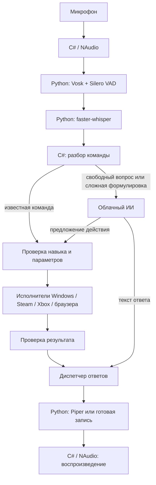

# JARVIS для Windows — выбор технологий

**Версия:** 0.2 · **Дата:** 8 ноября 2026 года.

**Статус:** архитектурный план и выбранный стек. Пользователь выбрал режим «базовые команды локально, облачный ИИ — по необходимости». Реализована локальная CPU-цепочка WPF / NAudio → Vosk / Silero / faster-whisper → исполнители навыков → Piper. Текущие возможности версии 0.7 и оставшиеся задачи — в [плане реализации](IMPLEMENTATION-STATUS.md). GPU-профиль, облачный ИИ, база данных SQLite и упаковка MSIX ещё не реализованы; каталоги и настройки пока хранятся в JSON.

Связанный документ: [проект и каталог 176 навыков](JARVIS-project-and-skills-catalog.md).

## 1. Решение

**Основа — C# / .NET 10 LTS / WPF. Голосовой модуль — отдельный процесс Python 3.12 x64.** Распознавание и базовая озвучка работают локально. Известные команды выполняет собственный движок правил. Для свободных вопросов и сложных формулировок подключается облачная языковая модель через заменяемый адаптер.

Это приложение для конкретного Windows-ПК: трей, микрофон, окна, звук, игры, браузер и скриншоты. Поэтому выбираем нативную Windows-основу и изолируем библиотеки машинного обучения. Цена решения — два языка, отдельный протокол обмена и более сложная упаковка. Выгода — сбой или перезагрузка голосовой модели не должны закрывать интерфейс и исполнитель команд.

Выбор технологий ниже — инженерная рекомендация под наши сценарии, а не результат сравнительного теста всех платформ.

## 2. Условия на компьютере

Проверено чтением сведений системы 8 ноября 2026 года:

| Компонент | Обнаружено | Следствие для проекта |
|---|---|---|
| Процессор | AMD Ryzen 7 9800X3D, 8 ядер; 16 логических процессоров | CPU-распознавание — разумный кандидат для игрового режима; задержку нужно измерить |
| Видеокарта | NVIDIA GeForce RTX 4080, 16 376 MiB видеопамяти | GPU-распознавание возможно; модели конкурируют за ресурсы с игрой |
| ОЗУ | Около 61,6 GiB видимой системе памяти | Объём позволяет рассматривать несколько локальных речевых компонентов |
| Windows | Сборка 26300.9818, значение DisplayVersion — 26H2 | Проверять приложение именно на этой сборке; маркетинговое имя из реестра неоднозначно |
| Доступный .NET SDK | В проверенном расположении найден 6.0.400 | Для разработки потребуется отдельный SDK .NET 10 |
| Активный Python | 3.13.11 | Для приложения создаём собственное окружение 3.12; от системного Python не зависим |

Это сведения об оборудовании, а не замеры скорости Джарвиса. Микрофон, использование колонок или гарнитуры, качество эхоподавления и влияние на FPS ещё не исследованы.

## 3. Основной стек

| Слой | Выбор | Для чего | Этап |
|---|---|---|---|
| Основное приложение | C# + .NET 10 LTS, x64 | Состояние помощника, команды, Windows-интеграции, управление дочерним процессом | Первая версия |
| Интерфейс | WPF + CommunityToolkit.Mvvm | Трей, настройки, индикатор микрофона, история, небольшая панель | Первая версия |
| Аудиоввод и воспроизведение | NAudio / WASAPI | Выбор устройств, микрофон, проигрывание ответов, восстановление подключения | Первая версия |
| Голосовой процесс | Python 3.12 x64, отдельное окружение | VAD, детектор имени, распознавание, синтез | Первая версия |
| Ожидание имени | Vosk, малая русская модель, ограниченный словарь | Обнаружить «Джарвис» без постоянного запуска большой модели | Кандидат для первого прототипа |
| Начало и конец реплики | Silero VAD через ONNX Runtime + таймеры | Отделять речь от пауз и ограничивать длину команды | Первая версия |
| Распознавание команды | faster-whisper / CTranslate2 | Русская речь и названия приложений; CPU и опционально CUDA | Первая версия |
| Разбор команд | Собственный реестр навыков в C#, шаблоны, синонимы, проверка параметров | Предсказуемо выполнять известные команды | Первая версия |
| Голос | Piper на CPU + кэш коротких ответов | Локальная озвучка без постоянной нагрузки на GPU | Первая версия; тембр выбрать прослушиванием |
| Запасная озвучка | Доступный Windows TTS-голос | Короткие ответы при недоступности Piper | После проверки русских голосов на ПК |
| Облачный ИИ | Адаптер провайдера через HTTPS, HttpClient | Свободные вопросы и перевод сложного запроса в известные навыки | После локальной основы |
| Windows-команды | Win32 / COM / WinRT, зарегистрированные ярлыки и URI | Запуск программ, окна, медиасессии, громкость, питание | Первая версия по списку навыков |
| Скриншоты | Windows.Graphics.Capture | Снимок выбранного окна или монитора | Первая версия |
| Резервное управление интерфейсом | FlaUI.UIA3 | Находить элементы приложений, когда нет прямого способа выполнить действие | По необходимости |
| Браузерная автоматизация | Playwright for .NET, отдельный профиль | Поиск и действия на сайтах | Следующий этап |
| Настройки и данные | JSON + SQLite / Microsoft.Data.Sqlite | Настройки, псевдонимы, сценарии, журнал результатов | Первая версия |
| Секреты | Windows DPAPI, область CurrentUser | Хранение ключей облачных сервисов | При подключении облака |
| Диагностика | Microsoft.Extensions.Logging + Serilog, ограниченная ротация файлов | Ошибки устройств и моделей, длительность операций | Первая версия |
| Проверки | xUnit для C#, pytest для Python, записанные речевые примеры | Правила, протокол, распознавание, восстановление после сбоя | Вместе с реализацией |
| Зависимости | NuGet с фиксацией версий; uv + uv.lock | Воспроизводимая сборка | С первого прототипа |

.NET 10 — актуальная LTS-ветка по проверенной таблице Microsoft. WPF предназначен для Windows; CommunityToolkit.Mvvm поддерживает WPF. Это соответствует выбранной платформе. [Политика .NET](https://dotnet.microsoft.com/en-us/platform/support/policy/dotnet-core), [WPF](https://learn.microsoft.com/en-us/dotnet/desktop/wpf/overview/), [MVVM Toolkit](https://learn.microsoft.com/en-us/dotnet/communitytoolkit/mvvm/).

NAudio предоставляет средства WASAPI; FlaUI — доступ к Windows UI Automation. Наличие библиотек не гарантирует поддержку каждого лаунчера или элемента интерфейса. [NAudio](https://github.com/naudio/NAudio), [FlaUI](https://github.com/FlaUI/FlaUI).

## 4. Как компоненты связаны

**C# владеет состоянием приложения и правом выполнять действия.** Python получает звук и текст, возвращает распознанную речь или аудио. Голосовой процесс не запускает произвольные команды Windows и не пишет в основную базу данных.

Для первой версии связь — перенаправленные stdin/stdout дочернего процесса: сообщения JSON Lines, идентификаторы запросов и сеансов, отдельный stderr для диагностических сообщений. Небольшие аудиофрагменты передаются как PCM в Base64 с указанными частотой, числом каналов и форматом. Это простой стартовый протокол; расходы на кодирование измеряем до его усложнения. Отдельный локальный HTTP-сервер для голоса не нужен.

Чтение и запись асинхронные; очереди ограничены. Команды отмены имеют приоритет, устаревшие ответы от прошлого сеанса отбрасываются. При зависании модели основной процесс может завершить голосовой процесс и запустить его заново. После перезапуска старое действие не повторяется автоматически. Модель загружается один раз на режим, а не заново на каждую фразу.

Для микрофона делаем кольцевой буфер: он сохраняет короткий предшествующий фрагмент, чтобы не потерять команду в слитной фразе «Джарвис, открой браузер». Общий формат входа для речевого контура — mono PCM 16 kHz; выход TTS сохраняет собственную частоту и преобразуется при воспроизведении.

## 5. Имя, распознавание и нагрузка в игре

### Активация

Первый кандидат — Vosk с русской моделью `vosk-model-small-ru-0.22` и ограниченным словарём обращения. У производителя есть русская малая модель размером 45 MB. Это распознаватель речи, который мы используем для поиска имени; качество именно такого детектора ещё не доказано. Нужно проверить наличие слова в словаре, слитную фразу с командой, ложные срабатывания на фильм и разные расстояния. [Модели Vosk](https://alphacephei.com/vosk/models).

Обязательный резерв — горячая клавиша «нажми и говори». Если Vosk плохо различает имя, заменяем только детектор обращения, сохраняя остальную систему. Готовый английский `hey_jarvis` из openWakeWord не принимаем за готовый русский «Джарвис»: проект указывает ограничения языковой поддержки. [openWakeWord](https://github.com/dscripka/openWakeWord).

Silero VAD определяет участки речи; таймер тишины и максимальная длительность записи завершают команду. Сам VAD не понимает смысл реплики и не распознаёт имя. [Silero VAD](https://github.com/snakers4/silero-vad).

### Два профиля распознавания

| Режим | Стартовая конфигурация для замера | Поведение |
|---|---|---|
| Игра | faster-whisper `small`, мультиязычная модель, CPU INT8 | Ограничить число потоков; GPU-модель не держать загруженной. Быстрые команды — локальные правила |
| Обычная работа | faster-whisper `large-v3-turbo`, CUDA, FP16 или INT8/FP16 после проверки | Допустить использование GPU для качества и скорости; без тяжёлой языковой модели в фоне |
| GPU недоступен | CPU-профиль | Явно показывать смену режима; голосовые команды сохраняются |

Модели в таблице — начальные точки эксперимента, а не обещание времени ответа. На CPU возможна конкуренция с игрой; этот режим тоже требует замера FPS и времени кадра. На первом этапе достаточно CPU-профиля, CUDA добавляется после работоспособной базовой цепочки.

faster-whisper поддерживает CPU INT8 и GPU-режимы. В текущей документации для актуального CTranslate2 указаны CUDA 12 / cuBLAS и cuDNN 9. Наличие NVIDIA-драйвера само по себе не подтверждает наличие этих библиотек. Совместимые версии и путь загрузки DLL фиксируем в сборке приложения. [faster-whisper](https://github.com/SYSTRAN/faster-whisper).

При переходе в игровой режим GPU-модель выгружаем; освобождение видеопамяти проверяем измерением. Если библиотека удерживает память, перезапускаем голосовой процесс в CPU-профиле. Во время переключения интерфейс показывает готовность, а не принимает команды в неизвестном состоянии.

### Колонки и собственный голос

NAudio отвечает за аудиоустройства, но его выбор не решает автоматически эхоподавление. Начальная проверка — на гарнитуре. Для колонок отдельно проверяем системное/драйверное эхоподавление; если его недостаточно, рассматриваем WebRTC AEC3 как отдельную интеграцию.

Первая версия может приостанавливать активацию по имени на время собственной озвучки, оставляя кнопку остановки ответа. Полноценное голосовое перебивание во время ответа и защита от речи фильма — отдельные критерии качества. Их нельзя обещать до акустических испытаний.

## 6. Движок команд и облачный ИИ

**Распознавание речи, понимание команды и выполнение действия — три самостоятельных этапа.** Локальная речевая модель превращает аудио в текст. Простые правила распознают навык и параметры. Исполнитель проверяет возможность действия, выполняет его и проверяет результат.

| Пример | Маршрут |
|---|---|
| «Джарвис, открой браузер» | Локальный текст → `app.launch` → выбранный браузер |
| «Сделай громкость тридцать процентов» | Локальный текст → `audio.set_volume`, значение 30 |
| «Запусти Ремнант» | Локальный словарь псевдонимов → конкретная игра; при нескольких совпадениях — уточнение |
| «Почему у меня мог пропасть звук?» | Облачный текстовый вопрос; системные сведения добавляются только по выбранной политике контекста |
| «Подготовь компьютер к фильму» | Если сценарий уже задан — локально; иначе ИИ предлагает план из известных навыков |

После настройки облачного провайдера свободные вопросы и нераспознанные сложные формулировки могут маршрутизироваться в ИИ автоматически по выбранному режиму. Переспрашивать разрешение на каждый обычный текстовый вопрос не требуется. Неопределённое имя игры сначала уточняем по локальному каталогу, а сбой распознавания не превращаем в произвольное действие.

Облаку передаём распознанный текст и необходимый контекст. Непрерывный звук микрофона туда не отправляем. Скриншоты и файлы добавляются только для соответствующей пользовательской команды или явно включённого режима. При отсутствии интернета базовые команды продолжают работать; облачный ответ возвращает понятную ошибку без повторного выполнения действий.

Провайдер и модель пока не зафиксированы: их выбираем отдельно по доступности сервиса из сети пользователя, качеству русского языка, работе с инструментами и бюджету. Архитектура использует единый контракт `IAiProvider`; у каждого провайдера может быть собственный API. Поддержка облака уже выбрана, выбор поставщика не должен задерживать локальный прототип.

Ответ ИИ с действием проходит тот же реестр навыков, схемы параметров и правила подтверждения, что и обычная команда. Неизвестные навыки отклоняются. Выполнение произвольного текста как PowerShell или командной строки не входит в архитектуру. Для выключения ПК и других прерывающих работу действий действуют правила подтверждения из каталога.

Ollama оставляем необязательным адаптером будущей полностью локальной конфигурации. Его API поддерживает инструменты и управление временем удержания модели. В первую поставку локальная языковая модель не обязательна. [Ollama API](https://docs.ollama.com/api/chat).

## 7. Голос Джарвиса

**Движок первой версии — Piper. Конкретный тембр выбираем на прослушивании.** Русские голоса доступны, но это не означает готового кинематографического Джарвиса. Сравниваем мужские голоса на именах игр, числах, ударениях, коротких репликах и длинном ответе. [Piper](https://github.com/OHF-Voice/piper1-gpl), [русские модели](https://huggingface.co/rhasspy/piper-voices/tree/main/ru/ru_RU).

Короткие фразы вроде «Слушаю», «Открываю», «Готово», «Не удалось запустить» заранее синтезируем выбранным голосом и кэшируем. Динамические ответы создаём при запросе. Ключ кэша учитывает голос, версию модели, текст и настройки; смена голоса не оставляет старые реплики. Итоговую реплику «Готово» произносим только после проверки результата.

Windows TTS — запасной путь после проверки установленного русского голоса. Более выразительный Qwen3-TTS или облачный синтез можно добавить позже через тот же интерфейс. Qwen3-TTS поддерживает русский, но его скорость и нагрузка на этом ПК ещё не проверены. [Qwen3-TTS](https://github.com/QwenLM/Qwen3-TTS).

У текущего Piper указана лицензия GPL-3.0-or-later, опубликован Windows x64 wheel. У голосовых моделей проверяем отдельные карточки и условия. До распространения приложения нужен список лицензий кода и моделей; разделение процессов само по себе не является заключением о лицензионных обязательствах. [Пакет Piper](https://pypi.org/project/piper-tts/).

## 8. Интеграции с Windows, играми и сайтами

| Задача | Реализация | Что подтвердить на прототипе |
|---|---|---|
| Открыть программу | Зарегистрированный путь, ярлык или штатный способ запуска; аргументы структурированы | Появление процесса/окна; повторная команда активирует уже открытое приложение, если это уместно |
| Steam | Каталог установленных игр, AppID и зарегистрированный механизм запуска Steam | Выбранные игры запускаются; готовность окна игры отличаем от открытия клиента |
| Xbox / Game Pass | Реестр реально установленных игр, их ярлыки и доступные способы активации, включая AUMID где применимо | Найти способ для каждой тестовой игры; универсальный путь к EXE не предполагается |
| Окна и звук | Windows API, медиасессии, WASAPI | Правильное окно/устройство; восстановление после сна и смены аудиовыхода |
| Скриншот | Windows.Graphics.Capture | Выбор монитора/окна, DPI, HDR, полноэкранный режим, файл результата |
| Управление приложением | Сначала прямой интерфейс; при необходимости FlaUI.UIA3 | Доступность элементов; отсутствие зависимости от фиксированных координат |
| Открыть сайт | URL в выбранном браузере | Открытие нужного адреса |
| Выполнить действия на сайте | Playwright for .NET с выделенным профилем | Авторизация, доступность элементов, поведение при изменении страницы |
| Включить фильм на Кинопоиске | Поиск → выбор результата → плеер → проверка состояния | Подписка, вход, DRM, воспроизведение в выбранном браузере; открытая страница ещё не означает начавшийся фильм |

У браузерной автоматизации будет собственный профиль с обычным входом пользователя. Playwright предупреждает, что автоматизация основного пользовательского профиля Chrome не поддерживается; один каталог профиля также нельзя одновременно использовать несколькими экземплярами. [Playwright: профили](https://playwright.dev/dotnet/docs/api/class-browsertype), [браузеры](https://playwright.dev/dotnet/docs/browsers).

Поддержка захвата экрана не означает возможность захватить защищённое видео: приложение или система могут блокировать захват. Для нашего навыка проверяем сохранение обычного рабочего стола и игровых окон. [Windows screen capture](https://learn.microsoft.com/en-us/windows/apps/develop/media-authoring-processing/screen-capture).

OCR добавляем позже: первый выбор — `Windows.Media.Ocr` в сборке с package identity. Microsoft указывает это требование для настольных приложений, поэтому OCR не делаем обязательным для первой переносимой сборки. [Документация OCR](https://github.com/MicrosoftDocs/winrt-api/blob/docs/windows.media.ocr/windows_media_ocr.md), [package identity](https://learn.microsoft.com/en-us/windows/apps/desktop/modernize/package-identity-overview).

## 9. Данные, сборка и доставка

- **JSON:** настройки устройств, выбранный профиль, экспорт сценариев и пользовательских псевдонимов. Поля и версии формата проверяются при загрузке.
- **SQLite:** структурированное состояние и история результатов. Пишет основной процесс C#; голосовой процесс обращается через сообщения. Миграции и резервная копия перед изменением формата. [Microsoft.Data.Sqlite](https://learn.microsoft.com/en-us/dotnet/standard/data/sqlite/).
- **DPAPI CurrentUser:** секреты провайдера. Не включать ключи в экспорт или журналы. Это привязка к Windows-пользователю, не защита от всех программ, работающих под тем же пользователем. [Windows Data Protection](https://learn.microsoft.com/en-us/dotnet/standard/security/how-to-use-data-protection).
- **Речевые данные:** звук по умолчанию только в оперативной памяти; сохранение тестовых записей — отдельный режим. Журнал ограничен по объёму и сроку хранения, без полного содержимого микрофона и секретов.
- **Версии:** фиксируем SDK через `global.json`, NuGet-зависимости и Python-зависимости через lock-файлы. `uv` используется для подготовки окружения и сборки, а не как обязательная команда на компьютере конечного пользователя. [uv: lock и sync](https://docs.astral.sh/uv/concepts/projects/sync/).
- **Первый запуск:** папка с self-contained .NET-приложением и собственным Python runtime. Не менять системный Python и его пакеты. Точные версии речевых библиотек утверждаются после проверки Windows x64-сборки и загрузки всех моделей.
- **Обычная доставка:** подписанный MSIX с package identity — целевой формат после прототипа. Проверить запуск дочернего процесса, доступ к микрофону, Win32-интеграции и обновление. Сертификат и способ распространения определить до выпуска.
- **Модели:** отдельные от исполняемого пакета, с версией, контрольной суммой и источником. Скачивание при настройке с показом объёма; после загрузки базовые команды работают без сети.
- **Автозапуск:** пользовательское приложение в трее, включаемая настройка запуска при входе в Windows. Постоянная системная служба для первой версии не требуется.

## 10. Почему не другие основы

| Вариант | Сильная сторона | Решение для нашего проекта |
|---|---|---|
| Python + PySide6 целиком | Один основной язык, быстрый речевой прототип | Подходит для демонстрации; для постоянного Windows-приложения предпочитаем C# и отдельный речевой процесс |
| C# без Python | Одна платформа и более простая доставка | Возможен через другие обёртки моделей; сейчас Python даёт более прямую интеграцию выбранных речевых библиотек |
| WinUI 3 вместо WPF | Современные Windows-компоненты | Требуемый трей, панель и настройки реализуем на WPF; смена UI-фреймворка не улучшает распознавание |
| Tauri + React + Python | Веб-интерфейс и межплатформенность | Добавляет JS/TS и Rust к Python; для текущего Windows-сценария усложнение пока не оправдано |
| Electron + Python | Знакомые веб-инструменты | Отдельный браузерный runtime не нужен для небольшой панели и настроек |
| Полностью облачный голос | Меньше локальных речевых компонентов | Не соответствует выбранной независимости базовых команд от сети |
| Большая локальная LLM в основе | Свободный диалог без облака | Не нужна для запуска игр и громкости; конкурирует с играми за ресурсы |

WPF не ограничивает оформление классическим серым окном. Визуальный стиль выберем отдельно, сохранив простой фоновой режим и понятный индикатор состояния микрофона.

## 11. Первый технический прототип и критерии

Цель прототипа — доказать совместимость выбранной цепочки на этом ПК до реализации большого каталога.

1. **Сборка:** чистое окружение Python 3.12 x64, зафиксированные пакеты; запуск Vosk, Silero, faster-whisper и Piper в одном дочернем процессе. Отдельно проверить CPU-вариант без CUDA.
2. **Полный цикл:** горячая клавиша → речь → текст → открытие браузера → проверка окна → голосовой ответ. Затем добавить обращение «Джарвис» без паузы перед командой.
3. **Практические навыки:** громкость, скриншот, одна Steam-игра и одна Xbox-игра. Это проверит разные способы исполнения; Кинопоиск вынести в отдельную браузерную пробу.
4. **Речь:** набор из минимум 50 записанных фраз пользователя, включая названия игр, числа, отрицания и неоднозначности. Измерять правильность выбранного навыка и параметров, а не только совпадение текста.
5. **Игровая нагрузка:** сравнить одинаковый игровой участок без помощника, в ожидании имени и при выполнении команды; записать время кадра, FPS, CPU, RAM, VRAM и задержку ответа.
6. **Устойчивость:** сон/пробуждение, отключение микрофона, смена устройства, падение голосового процесса, отсутствие сети, повтор одной команды и отмена. После сбоя не повторять действие без нового запроса.
7. **Акустика:** речь из фильма и игры, собственный голос помощника, гарнитура и колонки. Зафиксировать ложные активации за длительный сеанс и пропущенные обращения.
8. **Облако:** после выбора сервиса проверить свободный вопрос и одно действие через реестр навыков; измерить задержку и стоимость. Базовые команды должны проходить при отключённом облаке.

Рабочие цели, которые ещё не достигнуты: не менее 95% правильно выбранных навыков и параметров на согласованном наборе; медиана реакции на простую команду до 1,5 секунды после конца речи; 95-й перцентиль до 3 секунд. Ноль ошибочных запусков прерывающих работу действий в тестовом наборе. Порог приемлемого влияния на игру устанавливаем после первого замера.

Если CPU-профиль не укладывается в задержку, сначала сравниваем размер модели, потоки и декодирование. Если не хватает качества — сравниваем с GigaAM на тех же записях. Если не подходит тембр Piper — меняем TTS, сохраняя команды и UI. Ни одна из этих замен не требует переписывать всё приложение.

## 12. Что решено и что остаётся выбрать

**Определено пользователем:** Windows-ПК, русский язык, имя «Джарвис», сценарии Steam/Xbox/браузер/фильм/скриншоты; базовые команды локально, облачный ИИ по необходимости.

**Рекомендуется принять как основу:** C# + .NET 10 + WPF, отдельный Python 3.12-процесс, NAudio, Vosk + Silero + faster-whisper, Piper, собственный реестр навыков, SQLite и заменяемый облачный адаптер. Сначала CPU-цепочка, затем GPU-профиль и браузерная автоматизация.

**Требует практической проверки:** детектор русского имени, точные версии пакетов, выбранная ASR-модель, задержка и нагрузка, микрофон и эхо, запуск конкретных Xbox-игр, Кинопоиск и упаковка MSIX.

**Требует дальнейшего выбора:** голос после прослушивания; облачный провайдер, модель и бюджет; список первых игр, основной браузер и режим автозапуска. Эти вопросы не мешают зафиксировать архитектуру и подготовить локальный прототип.
